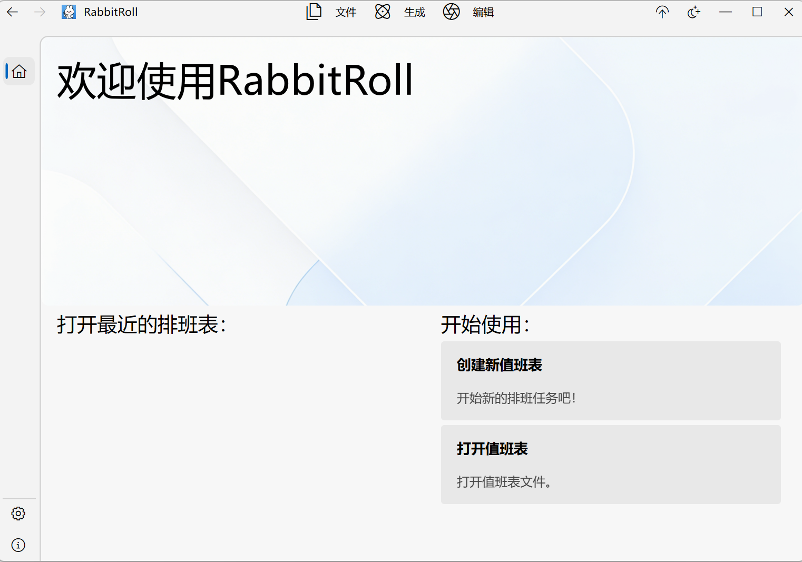

# RabbitRoll兔子排班

<p align="center">
  <a href="https://hub.xerj.org/contributors/Ireiium">
    
  </a>
</p>

RabbitRoll兔子排班是一款专注于解决团队排班问题的软件，尤其适用于大学生团队管理。它能够高效处理诸如高校学生组织/团队成员值班安排等繁琐事务，显著减少工作量。

程序支持平台：Windows。

<p align="center">
  
</p>

## 构建说明

### 构建环境

- **操作系统**：Windows x64。
- **Qt**：Qt 6.8.3，需安装 Core、Widgets、Concurrent、Network 模块。
- **编译器**：MSVC 2022 x64，搭配 Qt 的 `msvc2022_64` 套件。
- **构建工具**：Qt Creator，或 CMake GUI 配合 Visual Studio；CMake 版本需为 3.19 或更高。
- **Python**：编译源码需要完整的 64 位 Python 3.12 开发环境，包含解释器、开发头文件和链接库。

仓库中的 `libs` 目录提供 ElaWidgetTools、QXlsx 和 pybind11，`pythonembed/Windows` 已包含运行时使用的 Python 环境。运行构建、打包后的程序及排班脚本，无需另外安装 Python。

### 使用 Qt Creator 构建

1. 使用 Qt Creator 打开项目根目录的 `CMakeLists.txt`。
2. 选择 **Qt 6.8.3 / MSVC 2022 x64** 构建套件。
3. 在 CMake 配置中确认 Python 3.12 的路径；若无法自动找到，可设置 `Python3_ROOT_DIR` 为 Python 3.12 的安装目录。
4. 根据需要设置 `ENABLE_AI`，重新运行 CMake，再构建项目（见**开启或关闭 AI 排班**）。

### 使用 CMake GUI 和 Visual Studio 构建

1. 打开 CMake GUI，在 **Where is the source code** 中选择源码主根文件夹，即 `CMakeLists.txt` 所在文件夹。在根目录创建 `build` 文件夹，并在 **Where to build the binaries** 中选择该文件夹。
2. 点击【Add Entry】，名称输入 `CMAKE_PREFIX_PATH`，类型选择 `PATH`，Value 选择 Qt 文件夹下的 `6.8.3/msvc2022_64` 文件夹，最后点击【OK】。
3. 点击【Configure】，选择 **Visual Studio**，平台选择 **x64**，再点击【Finish】。若提示未找到 Python 开发环境，添加 `Python3_ROOT_DIR`，指向完整的 Python 3.12 安装目录，再次点击【Configure】。
4. 如需 AI 排班，确保勾选 `ENABLE_AI`；不需要则取消勾选。确认配置成功后，点击【Generate】。
5. 完成后点击【Open Project】，进入 Visual Studio。
6. 将 `RabbitRoll` 设为启动项目，并切换为 **Release / x64** 配置。
7. 选中 `RabbitRoll` 项目，按下 **Ctrl+B** 开始编译，也可以右键项目选择【生成】。使用上述构建目录时，当前源码的程序输出位置为 `build/src/Release/RabbitRoll.exe`。

当前 CMake 默认会在构建后自动部署 Qt 运行库，并复制 ElaWidgetTools 动态库、Python 环境、脚本和许可证文件。若程序提示缺少 `ElaWidgetTools.dll`，可将 `libs/ElaWidgetTools/bin` 中的对应文件拷贝至 `RabbitRoll.exe` 所在文件夹。也可以使用 Qt Creator 打开项目，完成构建后直接运行。

### 打包与部署

本项目采用 Windows 动态库部署方式，通过 CMake 安装规则收集程序、依赖库和资源。安装阶段会调用 Qt 的部署 API，在 Windows 上由 `windeployqt` 部署所需的 Qt 动态库及插件；ElaWidgetTools、Python 环境、脚本和许可证由项目安装规则单独处理。发布时使用与构建一致的 Qt 版本、编译器和 x64 架构，统一采用 Release 配置。

参考：[Qt 6.8 Windows 部署说明](https://doc.qt.io/qt-6.8/windows-deployment.html)、[Qt 6.8 CMake 运行时依赖部署 API](https://doc.qt.io/qt-6.8/qt-deploy-runtime-dependencies.html)。

#### 生成发布目录

1. 在 CMake GUI 中打开已配置的构建目录，将 `CMAKE_INSTALL_PREFIX` 设置为一个新的空目录，例如 `D:/RabbitRoll-package`，与源码目录、构建目录分开。
2. 依次点击【Configure】和【Generate】，确认配置、生成过程没有错误。
3. 点击【Open Project】，在 Visual Studio 中选择 **Release / x64**，先生成 `RabbitRoll` 项目，再生成 `INSTALL` 项目。
4. 检查安装输出，确认依赖部署成功。`CMAKE_INSTALL_PREFIX` 指定的目录即为待验证的发布目录。构建目录中的自动复制仅方便开发运行，正式分发使用安装生成的目录。

#### 检查依赖与资源

- **Qt 运行库与插件**：保留部署工具生成的目录结构，包括 `platforms/qwindows.dll` 等运行所需插件和生成的 `qt.conf`。不得混用 Debug 与 Release 文件，或混用其他 Qt 套件中的 DLL。
- **第三方依赖与 Python**：确认安装目录包含 ElaWidgetTools 动态库、`python312.dll`、`pythonembed`、示例脚本及许可文件。Qt 部署工具不负责收集全部第三方依赖，不能仅凭部署命令成功就认定发布包完整。
- **MSVC 运行库**：确认目标系统具备与构建工具链兼容的 x64 Visual C++ 运行库。若部署结果中包含 Visual C++ Redistributable 安装程序，应由发布安装程序调用，或说明由用户先安装；仅将安装程序放在目录里不会自动完成运行库安装。

> [!WARNING]
> 发布包不应包含个人考勤模板、成员数据、API key 文件 `ai-key.dat` 或其他敏感信息。
>
> 安装到已有目录不会自动清理历史文件，因此每次发布应使用新的空目录。发布者应在分发前检查发布包内容，并对自行打包、分发的内容负责。

#### 验证与分发

在未安装 Qt、Python 和开发工具的受支持 Windows x64 设备或干净虚拟机上，从发布目录直接启动 `RabbitRoll.exe`，验证文件保存与打开、成员管理、普通排班、Python 脚本排班和 Excel 导出。开启 AI 的版本还应使用测试者自己的 API key 验证 HTTPS 请求及 AI 排班，确认所需 TLS 后端及其运行依赖可用。

完成验证后，可将整个发布目录制作成压缩包，或作为安装程序的输入。当前 CMake 安装步骤生成的是部署目录，不会自动生成安装向导。分发时保留目录结构和许可证文件。

### 开启或关闭 AI 排班

CMake 选项 **`ENABLE_AI`** 控制是否将 AI 排班功能编译进程序，默认值为 `ON`。选项定义在 `src/CMakeLists.txt` 中：

```cmake
option(ENABLE_AI "Build with DeepSeek AI scheduling support" ON)
```

| 配置 | 构建结果 |
| --- | --- |
| 勾选 `ENABLE_AI`（`ON`） | 编译 AI 服务、DeepSeek 接口及 API key 存储代码，提供 AI 排班功能和相关设置。使用前仍需用户自行填写 API key。 |
| 取消勾选 `ENABLE_AI`（`OFF`） | 不编译上述 AI 服务代码，移除相关设置项，不提供 AI 排班能力；普通排班和 Python 脚本排班仍可使用。 |

**开启 AI 支持后**，CMake 会定义 `ENABLE_AI_SUPPORT` 编译宏，并为 AI 功能链接 Qt Network 和 Windows Crypt32。用户需进入【设置】→【启用 AI 排班】，打开功能开关，填写自己的 API key，按回车或离开输入框保存，再使用【AI 排班】。构建时开启 AI 支持不会自动提供 API key，也不会自动打开程序内的 AI 开关。

**开启或关闭 AI 支持的操作方式：**

- **Qt Creator**：在项目的构建设置中找到 CMake 配置项 `ENABLE_AI`，勾选或取消勾选，重新运行 CMake 后构建。
- **CMake GUI + Visual Studio**：在 CMake GUI 中勾选或取消勾选 `ENABLE_AI`，依次点击【Configure】和【Generate】，再回到 Visual Studio 重新构建。

`ENABLE_AI` 是编译选项，关闭后无法仅通过程序设置恢复 AI 功能，需要重新构建开启版。关闭 AI 后，当前 CMake 构建仍需要 Qt Network 和 Python 3.12 开发环境。

## 使用 RabbitRoll 的工作流

在高校团队值班管理中，通常由负责排班的成员收集部门所有成员的时间表，再一一核对每个成员可值班时间，协调出一份可执行的值班表。高校团队中，成员是否可值班往往取决于课程安排。

若团队成员规模大，手动核对每个成员可值班时间并协调各成员是一件极其耗时且效率低下的事。因此，RabbitRoll 提供了这样的解决方案：

1. 部门成员使用浏览器插件 **RabbitRoll 课表读取助手**，获取自己的课表。
2. 将读取的 `.rsch` 文件发送给部门负责排班的同学（下简称“负责人”）。
3. 负责人使用 RabbitRoll 程序读取 `.rsch` 文件后，即可一键排班。

您也可以直接在程序中编辑成员的个人时间表。

## 基本操作

刚启动程序时只有一个【主页】选项，创建或打开值班表后，即可看到其他工作按钮。

- **打开文件**：把 `.rroll` 文件拖入程序窗口即可打开。Windows 用户解压后先运行一次 `RabbitRoll.exe`，程序会为当前用户注册 `.rroll` 文件关联，无需管理员权限；此后可在资源管理器中双击打开。如果该扩展名已有其他默认程序，或 Windows 仍提示选择应用，请右键文件 →【打开方式】→ 选择本目录的 `RabbitRoll.exe`，并勾选始终使用。移动程序目录后，先从新目录运行一次以更新关联路径。
- **重复打开**：同一 Windows 用户重复启动 RabbitRoll 或双击项目时，会激活已有窗口并将文件交给它打开；同一文件不会重复加载，切换文件前会询问是否保存修改。保存、读取或其他模态对话框尚未结束时，新的文件打开请求会等待处理。一次拖入多个项目时只打开第一个 `.rroll` 文件。
- **文件**：文件保存和打开功能。
- **生成**：用于导入与导出。
- **置顶菜单**：点击后，窗口会一直保持在电脑桌面的最上层。
- **主题切换菜单**：切换窗口主题，支持白天、黑夜主题。
- **左侧导航栏**：切换当前页面。

## 成员模块

创建或打开一个值班表后，点击【成员】即可进入成员界面。

- **添加与删除**：点击【添加成员】即可添加一个成员；选择一个或多个成员后，点击【删除成员】即可删除，也可以右键选中一行进行删除。
- **属性管理**：点击【管理属性】，可以在弹窗中添加或删除属性。
- **批量添加**：默认情况下，在编辑栏中一行一行输入成员姓名，点击【确定】即可导入。若需要同时导入部门、电话等属性，点击【添加格式】，输入预设的格式，每个属性之间需要用空格隔开。也可以从【文件导入】中导入 `.rmem` 文件进行批量添加。
- **导出成员**：点击【导出】，或通过【生成】→【导出成员列表】，将成员信息以 `.rmem` 格式导出；也可以通过【导出成员列表为 Excel】导出为 `.xlsx` 文件。

### 通过 RSCH 批量导入成员与时间表

在【成员 → 批量添加】窗口中点击【通过RSCH导入】，即可一次选择多个 `.rsch` 文件，也可以选择文件夹或将文件拖入新窗口。

1. 设置文件名格式。默认是 `姓名`；若文件名为 `综合事务部 张三.rsch`，选择或输入 `部门 姓名`。自动解析属性或新建成员时，字段和值用空格分隔，格式必须包含一个“姓名”，还可使用 `部门 年级 姓名` 等自定义格式。手动对应已有成员不受文件名格式限制。
2. 选择导入方式。默认匹配已有成员，找不到时新建；如果已经添加了名单，可选择【仅更新已有成员】。重名时会参考文件名中的部门等属性，也可在预览的【对应成员】中手动选择。
3. 导入教务课表时，选择学期第一周的周一；普通时间表直接使用文件内日期。成功导入后会记住文件名格式和已设置的学期起点。
4. 检查下方每个文件对应的成员、属性、日期范围和处理结果。可使用【全选 / 全取消】切换整批勾选，也可单独勾选；多份文件对应同一成员时，需要只保留一份或重新指定对应关系。即使文件名无法按格式解析，只要 RSCH 内容有效，也可手动选择已有成员，此时仅导入时间表，保留原有成员属性。
5. 点击【确认导入】，在汇总窗口核对学期起点、导入人数、文件名格式及数据处理方式，再点击【确定导入】；点击【取消】返回预览，不写入数据。新属性会自动创建并显示，已有属性不会重复创建；默认只补充空属性，并合并不可值班时间。需要覆盖时，可在【已有数据】中选择覆盖属性或替换整个个人时间表。整批操作可通过【编辑 → 撤销】一次恢复。

此功能兼容明文和加密 RSCH，只读取源文件。取消窗口或尚未确认导入时，不会修改成员及其时间表。

### 单独查看或导入时间表

双击一行的成员，即可编辑和查看成员的详细信息，以及导入和导出该成员的时间表。

在【成员信息】浮窗中，双击【个人时间表】的表格，即可标记该成员某一天某时刻不能值班。点击【添加时间段】和【添加日期】，即可添加时间、日期。

点击【导入时间表】，可以导入先前保存好的 `.rsch` 文件，或者使用 RabbitRoll 课表读取助手获得的 `.rsch` 文件；点击【导出时间表】，即可把编辑好的时间表以 `.rsch` 文件导出。

## 编辑模块

点击【编辑】图标，即可进入排班编辑界面。

### 模式切换与排班处理逻辑

点击【切换到日期模式】或【切换到星期模式】，日期显示会变成周几或年月日，对应的程序内部排班逻辑也会有相应的变化。

当您编辑好某成员的时间表后，程序后台会自动计算：该成员在哪一天、哪一个时间段可以值班，哪一天、哪一个时间段无法值班。

因此，在对某一天某个时间段排班时，程序会直接告诉您哪些成员可以值班。您只需双击这个单元格，然后在左侧浮窗中进行勾选即可。

在周期模式下，只要成员在某一周的某一天无法值班，默认情况下，系统就不会将其放入对应星期、时间段的可值班候选人中。您可以通过【不可值班容忍度】调整这一规则。

### 一键排班

点击【一键排班】，设置【单次排班人数】，即可一键完成排班选择。单次排班人数指一个时间段中一共排多少人。

**注意：无论是一键排班还是 Python 脚本排班，都会直接覆盖原来的排班表。**

### 排班表设置

- **排班表名称**：由文件名确定。
- **不可值班容忍度**：仅对周期模式生效。例如，甲在 4 月份的周三 10:35-11:30 中，有一个星期无法值班。设置为 `0` 时，候选人不会含有甲；设置为 `1` 或更高时，候选人会含有甲。
- **启用日期筛选范围**：设置程序选择候选人时，只在设定的日期范围内查找。

## RabbitRoll 课表读取助手

[下载链接](https://github.com/Ireiium/GetClassForRabbitRoll)：点击`Code`-->`Download Zip` 下载后解压即可。

高校团队中值班的安排往往受到课程表的约束。因此，能够高效获取成员的课程表，是解决排班问题的重要步骤。

RabbitRoll 提供专门的课表读取助手浏览器插件，方便成员快速获取自己的课表。读取课表后以 `.rsch` 格式下载，可以直接导入 RabbitRoll 的个人时间表中。

本浏览器插件目前仅支持 **Edge 和 Google Chrome** 浏览器

目前已适配的高校如下：

| 适配高校 |
| --- |
| 武汉工程大学 |


### 导入与使用

1. 打开浏览器的扩展管理页面，开启【开发人员模式】。
2. 点击【加载解压缩的扩展】，找到并选择 `ClassScheduleReader_ForRabbitRoll` 文件夹，确保插件已开启。
3. 登录学校教务系统，进入自己的课程表页面。以武汉工程大学为例，进入【学期理论课表】，确保当前【周次】为全部。
4. 打开 RabbitRoll 课表读取助手，点击导出 `.rsch` 文件。若不成功，刷新页面重试。
5. 在 RabbitRoll 的成员个人时间表中导入该文件，选择好开学的第一天，点击【开始导入】。

## AI 排班功能

若有特殊的排班逻辑需要，可启用 AI 排班。

1. 进入【设置】，打开【启用 AI 排班】，填写 API key。
2. 进入编辑页面，点击【AI 排班】，输入要求，例如“把同一个部门的成员放在一起”。
3. 点击【选择属性】，把需要上传给 AI 的属性数据选中，例如“部门”，并确定。
4. 点击【开始计算】，完成排班。

## Python 脚本排班

脚本使用方法、入口格式和完整 API 说明见 [Python 脚本排班说明](scripts/README.md)。示例脚本及说明文档会随程序一起部署到 `scripts` 文件夹。

## 第三方许可说明与致谢

本项目采用 [MIT 许可证](LICENSE)。第三方组件遵循各自的许可证，相关许可文件见 [licenses](licenses/) 目录。

| 组件 | 许可证 |
| --- | --- |
| [Qt 6.8.3](https://www.qt.io/) | GNU Lesser General Public License v3.0 |
| [ElaWidgetTools](https://github.com/Liniyous/ElaWidgetTools) | MIT License |
| [QXlsx](https://github.com/QtExcel/QXlsx) | MIT License |
| [pybind11](https://github.com/pybind/pybind11) | BSD-style License |
| [QtMcp](https://github.com/signal-slot/qtmcp) | GNU Lesser General Public License v3.0（LGPL-3.0-only） |

本软件以动态链接方式使用 Qt 库。您有权在遵守 LGPLv3 协议的前提下，通过替换本软件目录下的 Qt 动态链接库文件，以实现测试、升级或修改的目的。您可以访问 Qt 官网获取完整源码。
